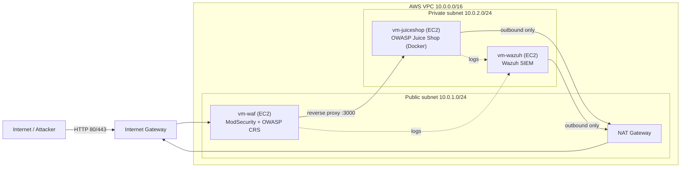

# Cloud Security & DevSecOps Lab — Build, Attack and Defend a Web App on AWS

Integrated lab project of ITS Piemonte in collaboration with **aizoOn** — **ByteLab (Group 1)**.

This repository deploys a complete security lab on **Amazon Web Services (AWS)** using Infrastructure as Code. A deliberately vulnerable web application (**OWASP Juice Shop**) runs behind a **ModSecurity WAF** with the OWASP Core Rule Set, while a **Wazuh SIEM** collects the logs of every component and detects attacks. All Terraform and Ansible code is scanned with **Checkov** before deployment.

> ⚠️ **Warning:** OWASP Juice Shop is intentionally vulnerable. Never expose it directly to the Internet: it must only be reachable through the WAF. Stop or destroy the environment when you are not using it.

---

## Architecture



| Instance | Subnet | Private IP | Public IP | Role |
| --- | --- | --- | --- | --- |
| `vm-waf` | Public | 10.0.1.10 | Yes (Elastic IP) | Reverse proxy with ModSecurity + OWASP CRS, the only entry point |
| `vm-juiceshop` | Private | 10.0.2.10 | No | OWASP Juice Shop in Docker (`bkimminich/juice-shop`) |
| `vm-wazuh` | Private | 10.0.2.20 | No | Wazuh server: centralized logs, detection rules, dashboard |

The public subnet routes to the Internet Gateway; only the WAF instance has a public IP. Private instances reach the Internet outbound only, through the NAT Gateway. Security groups allow just the traffic each instance needs.

---

## Tech stack

| Category | Tools |
| --- | --- |
| Cloud / IaC | AWS (VPC, EC2), Terraform |
| IaC security scan | Checkov |
| Configuration | Ansible |
| Containers | Docker |
| Target web app | OWASP Juice Shop |
| WAF | ModSecurity + OWASP Core Rule Set |
| SIEM | Wazuh |
| Versioning / CI | Git, GitHub Actions (Checkov on PRs) |

---

## Repository structure
.
├── terraform/ # Single Terraform project (flat layout)
│ ├── main.tf # VPC, subnets, IGW, NAT, route tables
│ ├── security.tf # Security groups and rules
│ ├── compute.tf # The 3 Ubuntu EC2 instances, key pair, Elastic IP
│ ├── ansible.tf # Generates the Ansible inventory and vars from outputs
│ ├── variables.tf
│ ├── outputs.tf
│ ├── versions.tf
│ └── templates/ # inventory.ini and lab_vars templates (rendered by Terraform)
├── ansible/
│ ├── site-waf.yml # WAF play (ModSecurity + OWASP CRS)
│ ├── site-wazuh.yml # Wazuh server play
│ ├── site-agents.yml # Wazuh agents on the WAF and Juice Shop instances
│ ├── roles/
│ │ ├── modsecurity/ # WAF reverse proxy + OWASP CRS
│ │ ├── wazuh_server/ # Wazuh SIEM server
│ │ └── wazuh_agent/ # Agents on WAF and Juice Shop
│ └── test/ # Vagrant-based local test setup
├── checkov/
│ └── reports/ # Checkov scan reports
└── docs/
├── assignments.md # Cloud/DevOps task breakdown
├── interfaces.md # Agreed names, CIDR ranges, ports, outputs
├── checkov-report.md # Checkov findings and decisions
├── client-documentation.md # End-client technical documentation
├── deploy-notes.md # Deployment notes
├── ssh-access.md # How to SSH in and reach the Wazuh dashboard
├── test-T12-wazuh.md # Wazuh server test record
└── test-T13-modsecurity.md # ModSecurity WAF test record


> **State:** Terraform uses **local state**. Juice Shop is currently provisioned via Terraform `user_data` (Docker); moving it into an Ansible role is a planned improvement.

---

## Prerequisites

- An AWS account with permissions for VPC and EC2, and the [AWS CLI](https://docs.aws.amazon.com/cli/latest/userguide/getting-started-install.html)
- Terraform
- Ansible
- Checkov (`pipx install checkov`)
- A `terraform.tfvars` with `admin_cidrs` and `allowed_cidrs` set to the IPs allowed to reach the lab (never committed)

---

## Quick start

**1. Configure AWS credentials**

```bash
aws configure            # or paste temporary credentials into ~/.aws/credentials
aws sts get-caller-identity
```

**2. Set the allowed IPs**

Create `terraform/terraform.tfvars` with the public IPs allowed to reach the lab:

```hcl
admin_cidrs   = ["YOUR.IP/32"]
allowed_cidrs = ["YOUR.IP/32"]
```

Find your public IP with `curl -s ifconfig.me`. This file is gitignored — never commit it.

**3. Scan the IaC code with Checkov**

```bash
checkov -d terraform/
```

**4. Deploy the infrastructure**

```bash
cd terraform
terraform init
terraform apply
```

Terraform outputs the WAF public IP and the private IPs, and generates `ansible/inventory.ini`. The private instances are reached through the WAF as an SSH jump host. Run `terraform output` at any time to see the current IPs and ready-made SSH commands.

**5. Configure the instances (from the repo root)**

```bash
ansible all -i terraform/ansible/inventory.ini -m ping
ansible-playbook -i terraform/ansible/inventory.ini ansible/site-wazuh.yml   # ~40 min (all-in-one install)
ansible-playbook -i terraform/ansible/inventory.ini ansible/site-waf.yml
ansible-playbook -i terraform/ansible/inventory.ini ansible/site-agents.yml
```

The WAF mode can be set with `-e waf_mode=off|detection|blocking` on the WAF play.

**6. Verify**

- Juice Shop is reachable at `http://<waf_public_ip>` (through ModSecurity)
- The WAF and Juice Shop agents show **Active** in the Wazuh dashboard
- See `docs/ssh-access.md` for reaching the Wazuh dashboard via SSH tunnel

**7. Destroy when finished**

```bash
cd terraform
terraform destroy
```

---

## Project phases

| Phase | Goal | Output |
| --- | --- | --- |
| 1 — Cloud & DevOps | Terraform pipeline, Checkov scan, instances configured with Ansible | Working AWS environment + Checkov report |
| 2 — Offensive | Vulnerability assessment of Juice Shop, goal: admin login | Vulnerability assessment report + evidence |
| 3 — Defense | WAF protects Juice Shop; Wazuh collects component and attack logs | Active WAF + SIEM dashboard + detection rules |
| Final | Cost analysis, documentation, demo | Final report, presentation, this repository |

---

## Working rules

- One feature branch per task, named after its ID (e.g. `T06-network`)
- Merge to `main` only through a pull request with at least one reviewer
- Run Checkov before every merge that touches `terraform/`
- **Never commit** AWS credentials, private keys, `.tfstate` files, `terraform.tfvars`, or SSH keys
- Stop or destroy the instances at the end of every working session (the NAT Gateway is billed by the hour too)

---

## Team — ByteLab (Group 1)

**Cloud / DevOps** (Phase 1: infrastructure, automation, IaC security, costs)

| Name | Area |
| --- | --- |
| Ngumo Esther Wanjiru | Team leader — network, Terraform integration, Checkov, coordination |
| Pironato Matteo | Compute (EC2), Terraform infrastructure, Juice Shop, cost analysis |
| Chemmam Farouq | ModSecurity WAF, Wazuh SIEM, documentation |

**Cyber Security** (Phases 2–3: attack scenarios, vulnerability assessment, WAF tuning, SIEM detection rules)

| Name | Area |
| --- | --- |
| Di Vincenzo Fabio | Offensive — vulnerability assessment of Juice Shop, admin login (Phase 2) |
| Moccia Paolo | Offensive — vulnerability assessment of Juice Shop, admin login (Phase 2) |
| Li Vigni Samuel Renato | Defensive — ModSecurity WAF tuning, Wazuh detection rules and dashboard (Phase 3) |
| Romanu Flavio | Defensive — ModSecurity WAF tuning, Wazuh detection rules and dashboard (Phase 3) |

---

## Disclaimer

This project is for educational purposes only. Attack techniques must be used exclusively against the lab environment deployed by this repository.
