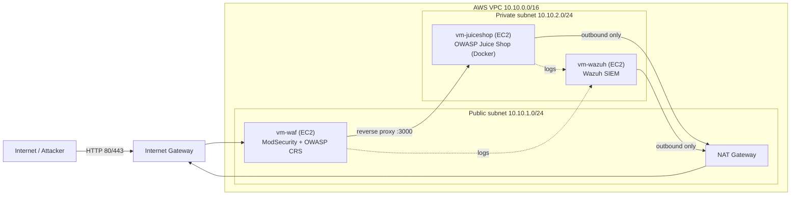

# Cloud Security & DevSecOps Lab — Build, Attack and Defend a Web App on AWS

Integrated lab project of ITS Piemonte in collaboration with **aizoOn** — **ByteLab (Group 1)**.

This repository deploys a complete security lab on **Amazon Web Services (AWS)** using Infrastructure as Code. A deliberately vulnerable web application (**OWASP Juice Shop**) runs behind a **ModSecurity WAF** with the OWASP Core Rule Set, while a **Wazuh SIEM** collects the logs of every component and detects attacks. All Terraform and Ansible code is scanned with **Checkov** before deployment.

> ⚠️ **Warning:** OWASP Juice Shop is intentionally vulnerable. Never expose it directly to the Internet: it must only be reachable through the WAF. Stop or destroy the environment when you are not using it.

---

## Architecture



| Instance | Subnet | Public IP | Role |
| --- | --- | --- | --- |
| `vm-waf` | Public | Yes (Elastic IP) | Reverse proxy with ModSecurity + OWASP CRS, the only entry point |
| `vm-juiceshop` | Private | No | OWASP Juice Shop in Docker (`bkimminich/juice-shop`) |
| `vm-wazuh` | Private | No | Wazuh server: centralized logs, detection rules, dashboard |

The public subnet routes to the Internet Gateway; only the WAF instance has a public IP. Private instances reach the Internet outbound only, through the NAT Gateway. Security groups allow just the traffic each instance needs.

---

## Tech stack

| Category | Tools |
| --- | --- |
| Cloud / IaC | AWS (VPC, EC2), Terraform |
| IaC security scan | Checkov |
| Configuration | Ansible |
| Containers | Docker |
| Target web app | OWASP Juice Shop |
| WAF | ModSecurity + OWASP Core Rule Set |
| SIEM | Wazuh |
| Versioning / CI-CD | Git, GitHub Actions (optional) |

---

## Repository structure

```
.
├── terraform/
│   ├── network/          # VPC, subnets, Internet Gateway, NAT Gateway, route tables, security groups
│   ├── compute/          # The 3 Ubuntu EC2 instances, key pair, Elastic IP, outputs
│   └── backend.tf        # Remote state in an S3 bucket with state locking
├── ansible/
│   ├── inventory.ini     # Generated from Terraform outputs (not edited by hand)
│   ├── site.yml          # Main playbook
│   └── roles/
│       ├── base/         # Updates, basic hardening, Docker
│       ├── juiceshop/    # OWASP Juice Shop container
│       ├── modsecurity/  # WAF reverse proxy + OWASP CRS
│       ├── wazuh_server/ # Wazuh SIEM
│       └── wazuh_agent/  # Agents on WAF and Juice Shop instances
├── checkov/
│   └── reports/          # Checkov scan reports
└── docs/
    ├── interfaces.md     # Agreed names, CIDR ranges, ports, outputs
    ├── architecture.md
    ├── cost-analysis.md
    └── technical-documentation.md
```

---

## Prerequisites

- An AWS account with permissions for VPC and EC2, and the [AWS CLI](https://docs.aws.amazon.com/cli/latest/userguide/getting-started-install.html)
- Terraform
- Ansible
- Checkov (`pip install checkov`)
- An SSH key pair (imported into AWS as an EC2 key pair by Terraform)

---

## Quick start

**1. Configure AWS credentials**

```bash
aws configure            # or paste temporary credentials into ~/.aws/credentials
aws sts get-caller-identity
```

**2. Scan the IaC code with Checkov**

```bash
checkov -d terraform/
checkov -d ansible/
```

**3. Deploy the infrastructure**

```bash
cd terraform
terraform init
terraform plan -out tfplan
terraform apply tfplan
```

Terraform outputs the WAF public IP and the private IPs, and generates `ansible/inventory.ini`. The private instances are reached through the WAF as an SSH jump host.

**4. Configure the instances**

```bash
cd ../ansible
ansible all -m ping
ansible-playbook site.yml
```

**5. Verify**

- Juice Shop is reachable at `http://<waf_public_ip>`
- WAF and Juice Shop agents are active in the Wazuh dashboard

**6. Destroy when finished**

```bash
cd ../terraform
terraform destroy
```

---

## Project phases

| Phase | Goal | Output |
| --- | --- | --- |
| 1 — Cloud & DevOps | Terraform pipeline, Checkov scan, instances configured with Ansible | Working AWS environment + Checkov report |
| 2 — Offensive | Vulnerability assessment of Juice Shop, goal: admin login | Vulnerability assessment report + evidence |
| 3 — Defense | WAF protects Juice Shop; Wazuh collects component and attack logs | Active WAF + SIEM dashboard + detection rules |
| Final | Cost analysis, documentation, demo | Final report, presentation, this repository |

---

## Working rules

- One feature branch per task, named after its ID (e.g. `T06-network`)
- Merge to `main` only through a merge request with at least one reviewer
- Run Checkov before every merge that touches `terraform/` or `ansible/`
- **Never commit** AWS credentials, private keys, `.tfstate` files or `.tfvars` with secrets
- Stop or destroy the instances at the end of every working session (the NAT Gateway is billed by the hour too)

---

## Team — ByteLab (Group 1)

**Cloud / DevOps** (Phase 1: infrastructure, automation, IaC security, costs)

| Name | Area |
| --- | --- |
| Ngumo Esther Wanjiru | Team leader — network, Terraform core, Checkov, integration |
| Chemmam Farouq | _to assign_ |
| Pironato Matteo | _to assign_ |

Areas: team leader (network, Terraform core, Checkov, integration) · compute, Ansible foundation, Juice Shop, cost analysis · ModSecurity WAF, Wazuh SIEM, documentation.

**Cyber Security** (Phases 2–3: attack scenarios, vulnerability assessment, WAF tuning, SIEM detection rules)

| Name | Area |
| --- | --- |
| Di Vincenzo Fabio | Offensive — vulnerability assessment of Juice Shop, admin login (Phase 2) |
| Moccia Paolo | Offensive — vulnerability assessment of Juice Shop, admin login (Phase 2) |
| Li Vigni Samuel Renato | Defensive — ModSecurity WAF tuning, Wazuh detection rules and dashboard (Phase 3) |
| Romanu Flavio | Defensive — ModSecurity WAF tuning, Wazuh detection rules and dashboard (Phase 3) |

---

## Disclaimer

This project is for educational purposes only. Attack techniques must be used exclusively against the lab environment deployed by this repository.
